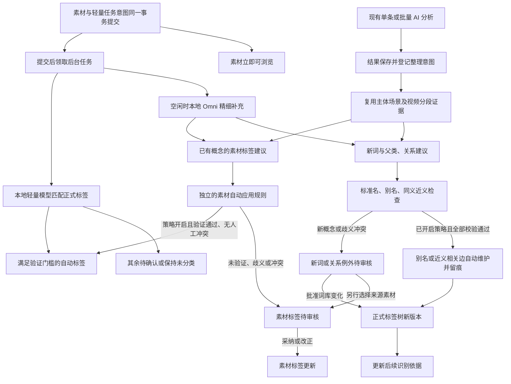

# 智能分类与标签树维护 — 产品设计草案

基线：同目录 `requirements.md`，2026-10-30。用户已同意纳入开发前评审 S01～S10、动态图集与例图辅助分类；本稿同步这些产品规则，用户随后确认继续 Kiro 开发，授权为 GRANTED_DEV_ISOLATED。前文为目标方案，开发基线见第14节；具体已实现与待完成内容见实施进度，不把目标当作已有功能。

关键页面的[四张 UI 视觉设计稿 v2](ui/README.md)用于评审全局侧栏树、AI 关系维护、合并和拆分操作。后续补充的角标、查询及增强功能尚未绘入 PNG。图稿是示意数据，不代表功能或算法已实现；规则以本稿与需求草案为准。

## 1. 信息架构

侧栏浏览区按顺序保留素材库及其文件夹树、我的喜欢，新增“智能分类”“标签树维护”，再接查找重复；工程与设置位置保持。

| 入口 | 回答的问题 | 内容 |
| --- | --- | --- |
| 智能分类 | 我有哪些内容，怎样找到它们？ | 场景／主体等分类树、素材结果、素材标签待审、后台任务 |
| 标签树维护 | 我的分类体系应该怎样组织？ | 正式树、节点与关系编辑、新词待审、变更历史 |

素材库仍按真实文件夹组织；智能分类只提供虚拟视图。检查器沿用现有开关位置、尺寸和主题，不重做全局布局。两个入口的标签树都在全局左侧各自入口下展开，主区不再放第二棵树或常驻子菜单。智能分类节点打开图集，维护节点打开编辑内容；默认仅当前入口展开，二者共享概念 ID，但分别记忆展开与滚动。

建议页面定位（路由名称待技术设计）：`#/classify`、`#/taxonomy`。分类节点使用稳定 ID，不把标签文字拼成唯一定位依据。

## 2. 智能分类页面

```text
全局 header：智能分类 / 场景 / 自然环境 / 山地
┌全局左侧菜单────────┬────────────────────────────────┐
│ 素材库             │ 搜索 · 类型 · 文件夹 · 状态  视图 检查器 │
│ 我的喜欢           ├────────────────────────────────┤
│ ▾ 智能分类         │ 缩略图网格／列表／时间视图          │
│   ▾ 场景           │ 复用现有卡片、选择和右键菜单        │
│     ▾ 自然环境     │ 标签及来源在检查器紧凑展示          │
│       ● 山地       │                                  │
│   ▸ 主体           │                                  │
│   ▸ 活动           │                                  │
│   ▸ 视觉特征       │                                  │
│   未分类／待确认   │                                  │
│ ▸ 标签树维护       ├────────────────────────────────┤
│ 查找重复           │ 去重素材数 · 已选数   后台分类 / 暂停 │
└────────────────────┴────────────────────────────────┘
```

标签树使用全局侧栏的可用宽度；进入分类入口时显示该入口的树，不替代素材库真实目录。收起全局侧栏时提供可键盘操作的临时树浮层，关闭即回到原视图；不增加常驻次级栏，不默认额外展开检查器而挤压素材。保持既有主区顶端紧凑筛选栏，数量放 footer，不恢复大标题占位。

顶部“分类浏览／素材标签待审”切换不改变全局布局。任务进度默认一行，点击展开等待原因、成功／失败数和暂停／取消。未配置时显示“配置本地分类”，不自动下载。

现有综合搜索已经索引标签文字，但尚无专属概念过滤、同义解析或父子语义。普通输入回车保留全文搜索；下拉同时提供全文搜索与带完整路径的标签项，只有明确选中标签才生成筛选 chip。标准名和已生效别名解析到稳定概念 ID，歧义先选择路径。标签组合提供“任一符合／全部符合／不包含”，正向标签默认任一，其他筛选维度取交集；同一维度也能表达“人物且自行车”；不同条件的组合关系始终可见。不包含仅影响本次查询，不写入素材的永久排除决定。

选择父节点默认含后代并去重，可切换仅本级。合并后的旧词可定位目标；拆分旧词展示新路径及原标签待判断项的分流提示，不自动选择某个目标。不新增独立搜索引擎。相关词提供“也看看……”建议，只有用户点击才改变查询。检查器将标签分为人工确认、自动标签、待确认，以小标记区别；不在每张卡片堆满标签。

两个入口都提供树内查找，支持标准名和已生效别名，显示完整路径、展开祖先并定位匹配项。分类浏览可以隐藏空节点，查找时仍能定位被隐藏的匹配后代；维护页显示全部节点。保持人工设定的稳定排序，不按使用频率自动重排，不新增第二侧栏。

默认列表和树计数只计算人工确认、已生效自动标签、已应用历史映射。Omni 或分析结果映射只有通过已开启且经过独立验证的自动应用规则，才能把无人工冲突的已有概念正向补充计入；词已存在本身不是自动应用条件。其余建议进入待审视图，不计正式数量。

### 2.1 所有素材浏览视图的标签角标

有至少一个已生效标签的素材显示一个小标签图标；默认不在图标旁堆数字，悬停／键盘聚焦显示“已添加 N 个标签”，查看具体内容沿用检查器或详情。旧手工标签同样计入。数量按直接已生效概念去重，别名、自动汇总祖先及待审建议不额外计数；合并后的旧引用解析到同一目标。AI 已分析、有标签是两个独立状态：分析完成但没有生效标签时只亮 AI 图标；手工标签无需 AI 分析也亮标签图标。

覆盖素材库、我的喜欢、智能分类及搜索结果的网格／瀑布流／时间分组／列表／表格；素材选择器、重复／相似结果和工程素材列表遵守同一规则。普通卡片接入既有角标区域，紧凑列表放在已有状态图标区；使用主题色和必要的低调衬底，不靠颜色单独区分，不增加整列标签文字。图标不改变卡片点击、双击、框选或拖拽语义，也不遮挡堆叠计数。折叠堆叠只描述代表素材，展开后逐张显示。

列表数据应批量提供已生效标签数量及摘要修订（具体字段待技术设计），不逐张请求。新增、采纳、合并、拆分、移除最后标签及后台整理后定向刷新；保持排序、分页、滚动与选中。摘要未知与明确为零区分，延迟或失败不擦掉已知标签状态。本轮是在 v2 图稿基础上补充角标规则，现有 PNG 尚未绘入该新增标记。

## 3. 标签树维护页面

```text
header：标签树维护
┌全局左侧菜单────────┬────────────────────────────────┐
│ 素材库             │ 节点内容  新词／关系例外  变更历史 │
│ 我的喜欢           ├────────────────────────────────┤
│ ▸ 智能分类         │ 标准词：自行车                   │
│ ▾ 标签树维护       │ 路径：主体 / 交通工具 / 非机动车  │
│   ▾ 主体           │ 说明：人力驱动的两轮车…            │
│     ▾ 交通工具     │ 别名：单车、bicycle  AI 已维护     │
│       ▾ 非机动车   │ 近义／相关：电动自行车             │
│         ● 自行车   │ 排除说明：不含摩托车               │
│   + 新增同级/子级  │ 查看素材  移动  合并  拆分  停用  │
│ 查找重复           │ 自动关系记录 · 纠正／撤销          │
└────────────────────┴────────────────────────────────┘
```

树箭头与节点选择保持独立焦点，箭头中性，节点使用当前主题色，沿用已确认的文件夹树紧凑间距。四级节点完整路径用面包屑或提示呈现；别名不作为额外层级。

新建面板先用本地索引检查标准名和已生效别名；语义关系检查异步运行，结果就地提示。模型未配置、忙碌或失败都不阻止合法的人工保存，关系状态可标为“待整理”。分三种结果：

1. **已有标准词或唯一已生效别名**：直接定位旧节点；表达归一不自动采纳待审素材关联。
2. **新的同义／近义表达**：已开启自动维护且定义、父类语境、互斥、别名占用、人工锁均通过时自动补充别名或关系，显示依据与撤销入口；多义及冲突才进入例外待审。已有两个概念时不得借“增加别名”自动合并。
3. **没有确定匹配**：允许人工新建并选择父级，可先成为独立一级节点；后续 AI 发现与已有概念重复时只建议正式合并，不静默合并。模型自行提议的新概念仍需批准。

节点内容就地显示 AI 已维护的别名、近义／相关关系、来源和纠正入口；“关系例外”集中处理歧义及冲突，不建立逐条人工确认的日常工作流。首次开启自动关系维护时说明写入范围；生效记录带模型、策略、校验依据与版本，支持撤销。人工锁定的关系不被自动任务修改。标准名及已生效别名用于归一搜索；未生效候选不进入词库上下文。字符规范化、向量相似和模型自评百分比都不能单独证明同义。

## 4. 标签体系建议

下表是初始化方案示意，不代表强制行业标准或本轮实际建库。用户可增删根维度；不要求每个素材、每条分支都有四级。

| 一级 | 二级 | 三级 | 四级示例 |
| --- | --- | --- | --- |
| 场景 | 自然环境 | 山地 | 雪山 |
| 场景 | 城市环境 | 街道 | 老街 |
| 场景 | 室内空间 | 居家空间 | 厨房 |
| 主体 | 建筑 | 宗教建筑 | 佛塔 |
| 主体 | 植物 | 花卉 | 荷花 |
| 主体 | 植物 | 植物部位 | 树叶 |
| 主体 | 交通工具 | 非机动车 | 自行车 |
| 主体 | 文档 | 身份凭证 | 护照 |
| 活动 | 生活活动 | 餐饮 | 聚餐 |
| 视觉特征 | 光线 | 光照方向 | 逆光 |

人物只提供可观察的普通主体分类；具体姓名与同一人聚类由未来人物功能承载。对文档只识别类别，不把证件号码识别成标签。气氛、艺术风格等主观项先作为建议，不与客观主体共用自动应用门槛。

一个标准概念只有一个树父级；跨维度联系由“相关”关系表达。近义是两概念之间的关系，不传播素材关联、不等同父子；同义表达是同概念的别名。把“雪山”和“山地”设为父子，不能因为接近而合并；“山峰”和“山脉”也不自动当别名。

## 5. 三段处理与写入边界



新增分类推理不加入导入完成条件。现有导入的 ResNet 相似度计算是否异步化另作性能决策，本期不以此条暗改既有流程。自动标签是可见、可筛选、可撤销的机器结果，人工确认后升级为受保护决定。用户开启素材自动应用策略后，Omni 对已有概念的正向补充可在独立验证的类别／规则范围内自动生效；未验证类别、主观项、歧义、冲突和修改人工决定仍待审，不凭模型自评分、模型一致或词频放行。

别名／关系自动维护与素材标签自动应用是两项独立策略；前者的启用或成功不代表后者获准。新概念未经审核不进入正式树；批准新词不同时批准所有来源素材。词库采纳与素材关联分别操作，防止一次错误批量扩散。

模型只是候选来源；规则层验证深度、关系、重复、来源、版本及人工保护。识别上下文仅使用已批准概念及已生效定义和别名；大词库需要受控分支检索和遗漏测试，不能无限拼进 prompt 或悄悄丢弃自定义长尾词。新词未经审核时不喂给后续图片。

### 5.1 接入现有单条／批量 AI 分析

在已有分析确认区域增加“同时整理标签”，分析与标签整理选项分别记忆；首期只用于图片和视频，音频继续沿用既有分析功能。用户不必另起一次视觉识别；启用后每张／每段分析成功便按素材进入统一标签整理流程，不等整批结束。现有主体、场景、光线、天气等结构化结果足以作为第一版映射输入；自由描述、主观项、未知词和歧义不能强行当成确定标签。需要扩大模型输出结构或另一次精细分析时另按明确任务处理，不以这个选项隐式增加调用。沿用用户本次所选本地／云端分析结果，标签整理本身不把完整私有词库发送到云端。

“跳过已分析素材”只跳过重新识别；标签整理已开启时，仍可对保存的结果执行缺失的整理，进度区分“新分析／复用已有结果／标签整理／待确认／整理失败”。无可用结果时说明原因，不偷偷发起重新分析。视频沿用已保存的分段时间证据，来源标识为完整分析结果映射；独立快速分类的封面结果仍标明其范围。

现有接入点是 gallery.js 的批量确认及 batchAnalyze、analysis.py 的 start_batch_analysis 和共用 save_segments。当前后者保存结果、更新 analysis_status 并刷新 FTS，尚未建立正式标签关联。设计上在保存分析结果的同一事务登记轻量整理意图，提交后再匹配／推理；不能把可能失败的整理代码直接串入现有分析 worker 的大异常捕获，造成“分析已保存却被标为失败”。标签任务单独重试，按素材、分析修订及实际相关词库／策略依据校验和去重。复用结果同样遵守上文已接受的自动应用规则与人工保护，不因结果出自完整分析就免除验证。

### 5.2 自定义标签与输入质量

中文显示名与识别描述分开维护，并保留描述来源和版本；若使用翻译描述，应可查看和修正。新增标签可先保存、手工赋予和搜索，在识别依据尚未准备好时明确显示状态。轻量模型需具备同版本配套的本地文字编码路径，禁止拼接不同模型的图像／文本特征或隐式回退云端。之前固定英文候选和预缓存文字向量的测速不能证明任意中文标签可直接使用。

首发模型选择前，用独立真值检验常见中文、同义／多义表达、细分类及用户自定义类别；分别记录标签可保存、可检索、可识别的延迟，以及冷启动、会话重建和稳态成本。词表或识别描述改变时复核相关门槛，不把相似分数当概率。

记录识别输入的预览修订、尺寸和视频时间。现有常规图片预览宽约 320，视频默认约第 1 秒；缺失、黑帧或信息不足可弃权并标为“参考画面不足”，不能据此判断主体不存在。优先使用缓存；更大预览或替换代表帧仅在源素材在线且后台预算允许时补取，不阻塞导入，也不隐式扩为整段视频分析。

## 6. 补标与审核交互

新词列表按待审状态、来源数量和最近发现筛选；来源数量只帮助排序。展开一条可同时看数张来源、完整路径候选、原始依据及相近词。多个父类冲突需明确展示。

同名只作聚合展示。例如“苹果”可能指水果或品牌，维护者可按含义与来源拆成独立候选、分别选择路径；标准名和别名都允许存在需消歧的文字表达，概念以 ID 区分。未消歧前不能按同名一键采纳全部来源。拒绝建词仅关闭该具体含义及父类提议；重复提议追加来源但保持关闭，用户可主动重新考虑，不产生全库禁词。

例如 Omni 提出“单车”：若是自行车的唯一已生效别名，复用旧 ID；若是新表达且通过已开启策略的完整校验，可自动补为别名。有多个含义或已有“单车”概念 ID 时进入例外／正式合并方案。Omni 提出“山脉”而树里只有“山峰”：新概念仍待批准，两概念生效后可由策略维护近义／相关边，不以向量分数强制合并。

新词审核采纳时两个独立选项：“保存词库变更”“将选定素材加入该标签”。后者默认未选择，显示准确图片与数量。合并节点必须先决定后代归属、别名冲突和被排除的素材；任一冲突未解决则整项不提交。撤销按变更版本逆操作，发现后续编辑时先展示冲突，不恢复整库旧备份。

素材标签审核展示“当前结果 → 建议补充／更改”和可见依据，按“标签＋导入批次”分组，呈现代表样本、异常项及完整可查看的准确应用范围；支持整组处理并排除例外，不要求数千次单项弹窗。抽样展示不是整批正确的证据，未通过自动策略的结果仍需用户确认具体批量范围。已有人工确认默认保留；拒绝会形成明确排除。一次模型补跑不会清除排除；概念合并后排除随目标 ID 迁移并优先阻止自动重新附回。

父级移除提供两种明确操作。“移除直接标签”只移除显式关联，例如移除“山地”后，“雪山”仍使素材出现在山地汇总，界面应提前说明。“排除此分类及子分类”先列出所有受影响标签，含人工确认项，用户明确确认后统一移除，并以稳定父节点 ID 记录子树排除，阻止后续 AI 通过后代间接加回。标签树移动、合并和拆分的影响预览也要包括这类排除范围变化。人工重新添加命中排除范围的标签时，须明确解除冲突范围的排除后再提交；不静默改变规则。

### 6.1 正式合并与拆分

两项操作都可从正式节点的菜单或编辑区发起。用户可直接选择合并目标、按选中素材配置拆分，或让 AI 辅助生成方案；模型缺失、忙碌、失败均不阻止手动路径。两种路径共享结构校验、影响预览及版本保护，查看整体影响后一次执行。处理的是已使用的概念，区别于上文待审同名候选拆分。方案显示目标定义／路径、受影响素材和重复数、人工确认及排除、子节点冲突、未判定项；可改目标和分配、取消或重新生成。模型给出的方案没有执行权。

**合并**：选定保留的目标 ID，旧概念保留引用映射与历史。素材去重但来源与证据不丢，双方全部别名默认完整保留；图稿中的别名 chip 仅为节选，不能据此删减。人工确认／排除冲突、别名占用、后代放置和超过四级都必须在执行前解决。例如“自行车”42 张、“单车”18 张，重叠 6 张，合并后 54 张；这是示意数，不能当模型精度证据。旧词仍可搜索到目标，歧义文字先消歧。

**拆分**：用户配置已有或新建目标、路径及素材分配，AI 可按含义辅助建议。每项可有零个、一个或多个目标；不强制均分，也不把全体素材复制到每个目标。可用“可分配／待判断／受保护或冲突”摘要检查，人工确认的转移要在方案中显式批准，不能因 AI 提议而失去保护。示意“苹果”36 张可分为水果 22、品牌 10、待判断 4；实际允许同图多归属，应另列跨目标重叠和去重总数。

未判定、冲突和未获准转移的人工确认保留原标签；原标签默认暂停新自动分配，但在还有未决素材或子节点归属时保持可访问，不自动停用。全部处理完后可按用户方案停用，别名、引用与历史不硬删除；搜索旧词给出新路径与原标签剩余项的分流提示。拆分不会把原标签的歧义别名复制成多个自动匹配别名；排除／子树范围变化须显式解决，旧排除仍保留证据且不得被任务绕过。

执行与撤销都检查词库、素材和人工决定版本，并在一个事务里更新关系与变更记录；取消、失败、过期方案不留部分结果。撤销只恢复本次变更，遇到之后的编辑冲突则拒绝覆盖并展示原因。

## 7. 概念数据与接口职责（非物理 schema）

| 对象 | 最少需要表达的内容 |
| --- | --- |
| 标签概念 | 稳定 ID、标准名、父 ID、定义、状态、排序、版本、时间 |
| 词表达与关系 | 别名及歧义、生效／候选状态、关系类型、概念端点、AI／人工来源、校验依据、人工锁和版本 |
| 素材标签 | 素材与概念、自动／确认状态、多来源、证据及片段范围 |
| 人工决定 | 确认、移除、拒绝、概念／子树作用范围、操作者和版本；不可被任务覆盖 |
| 候选 | 标准词候选及多种父类提议、来源素材、模型、依据、审核结论 |
| 分类任务 | 范围快照、输入修订、模型／词库／策略版本、阶段、租约、重试及等待原因 |
| 变更记录 | 词库及关联变更的前后值、范围、因果、合并引用／拆分分流、未决项、可撤销性 |
| 语义特征缓存 | 图像／文本模型与预处理版本、维度、输入或概念依据修订、有效性；与原相似度特征隔离 |
| 动态图集 | 名称、可读查询条件、稳定概念引用、条件版本与需调整状态，不复制素材 |
| 标签例图 | 概念、正例／易混反例、素材与输入修订、可移除引用，不替代素材标签决定 |

这是逻辑能力清单，不规定一对象一张表；实际 schema 由技术设计在最小实现原则下收敛。禁止只增加一个 `parent_id` 就把来源、人工排除和待审塞进不可追踪文本。

接口职责应覆盖树查询及影响预览、节点操作、合并／拆分方案与执行／撤销、关系自动维护及例外校验、素材检索及批量标签摘要、标签决定、候选审核、现有分析完成后的整理意图、任务控制及增量状态，以及动态图集条件和例图候选预览。保留旧 `/api/tags/` 的字段与 ID 兼容性；新增契约、分页、版本冲突和错误结构须在后续技术设计中落实，不在此文伪装成已存在 API。

分类和历史映射有独立状态，完整 AI 分析及片段不被重写。父类与祖先是查询时汇总，不为每个叶子重复保存整套父级关联。沿用 FTS 并增加概念解析与过滤职责，支持标准名、已生效别名，且不能把待审词当正式搜索结果悄悄加入。

### 7.1 缓存及按依赖更新

现有 `media.embedding` 是 ResNet50 的 2048 维相似度特征，服务喜欢堆叠和查重；保留其值与职责。CLIP／SigLIP 语义特征另存，并标明模型、预处理、维度及素材／预览修订。可以复用预览和运行环境，不能混用向量空间。

| 变化 | 需要更新 | 不应重复执行 |
| --- | --- | --- |
| 排序、纯显示名称 | 展示与搜索索引；确认识别描述未变 | 图像推理 |
| 新标签、定义或别名语义变化 | 相关文字编码、缓存图像匹配与受影响结果 | 未变化的图像编码 |
| 移动父类 | 汇总、子树排除及受影响查询；如使用父类语境则更新文字依据 | 无关分支推理 |
| 预览／源素材或图像模型变化 | 相应图像特征及依赖结果 | 无关素材推理 |

全局词库版本可作审计索引，但任务失效以实际读取的概念、定义、规则和输入修订为依据。无关分支变化不使整个队列重做；人工决定和排除范围的最新状态仍须在写回时核对。已有自动结果受依据变化影响时按新规则重评，不得覆盖人工决定。

## 8. 后台状态与异常

任务状态：排队、运行、暂停、等待资源、等待素材、失败、完成、取消；信息不足另记为可重试的输入原因，不冒充识别成功。阶段单列为快速匹配／Omni 精补／分析结果整理／历史映射／例图候选，不用一个百分比冒充全部完成。明确展示“词库待审”和“素材标签待审”，未审不等于任务仍在推理。

开启自动分类时，素材记录与轻量任务意图在同一 SQLite 事务提交；开启分析联动时，分析结果与整理意图同事务提交。推理与映射执行在提交后进行，不引入外部队列服务。登记失败不能声称已排队；恢复测试覆盖提交前后故障、重复领取和重启补跑，避免“素材已提交而任务丢失”的空隙。

领取任务及写回都核对素材修订、任务意图及实际相关词库依据。幂等键覆盖素材／分析修订、阶段、模型、策略和相关依据修订；重启仅回收过期租约，不重复产生标签。用户取消后迟到结果不得写回。有限重试及错误上限在技术设计中定案，队列不自旋。

后台默认单路 Omni。在用户启用范围内，显式请求优先，其次处理未分类、无法确定和细标签不足的素材；近期导入／常用素材可优先，但为旧队列保留份额以避免长期饥饿。已完成且输入与有效识别依据未变的任务不重复推理；时间预算或资源上限达到后暂停并保留进度。

执行权按单张／小批申请，有前台请求或导入、播放高负载时不领取新重任务，当前小批完成后让出；等待引擎期间也能取消。当前引擎使用计数和切换锁并不提供优先级，技术实现需显式协调调度。不要让整批长期占用执行权、启动多个约 20GB 模型进程或强行卸载前台租用模型。快速模型与 Omni 的并驻、切换及内存门槛必须实测后决定。

断电后保留已提交项，未完成项可继续。离线原片若已有可用缓存可分类；缓存也缺失则等待素材。发现素材替换时重新排队，不把旧图片标签写到新文件。失败不触发云端或付费回退。

## 9. 旧数据及交付约束

先在隔离副本清点旧标签和引用，保留 ID；虚拟“未归档”不占真实层级。既有分析只抽取结构化主体和场景作映射，先预览歧义、重复和关联数；自由描述需另行候选化。视频证据保留时间范围。

旧分析字段允许人工编辑，却没有逐项来源和排除历史。映射时保留原值快照、字段与片段引用，标为“历史资料，原始来源无法区分”；不伪造纯 AI 来源、人工确认或未记录的旧拒绝。可由用户明确确认一批映射为受保护基线。新版后的确认、移除与排除完整留痕，分类不改写原分析字段。

此前 128 张与 194 个词是实验结果，不自动导入正式库。未来如使用它们初始化候选，必须由用户选择批次，并核对素材仍存在及版本一致。

旧资料库导出迁移需覆盖新数据与任务恢复标记，包含动态图集条件、例图引用和修订；可再生缓存可单独处理，但恢复后不得混用失效特征。外部权重保持独立。schema 字段顺序遵从 AGENTS：新业务列在 `created_at` 前，最后两列依次 `created_at`、`updated_at`；原表漂移只登记，未授权不改。生产迁移失败停写留证，恢复和回滚需用户另行授权。

## 10. 正确性属性与验证

1. 树无环、单父、深度 ≤4；移动事务成功或完全不变。
2. 标准概念 ID 稳定；别名不产生第二份计数；近义不隐式扩大查询。
3. 人工排除及确认不被异步任务覆盖，包含取消、重启及合并／拆分竞态；所有范围变化需确认。
4. 单个素材在父级结果及多来源标签中只出现一次。
5. 词库采纳和素材关联互相独立；候选不污染已批准模型上下文。
6. 同一任务重复执行不产生额外概念、关联或候选。
7. 新功能不移动源文件、不写原片、不改变喜欢、评分或工程关系。
8. 自动关系维护只补充校验通过的表达／边，不自动创建新概念或合并既有概念，也不授予素材自动应用权限；素材补标另过已开启、独立验证且保护人工决定的规则。自动记录可追溯和撤销。
9. 合并去重且保留来源；拆分守恒、允许多归属且未决项不丢，旧词和引用始终有明确去向。
10. 查询排除不改变素材标签；动态图集条件失效不会被静默丢弃而扩大结果。
11. 例图候选不直接成为正式标签；例图删除或替换使相关依据失效，不撤销独立的人工决定。
12. 新增分类任务与素材／分析提交不丢失，缓存空间隔离，取消与依据变化不会产生过期写回。

| 需求 | 设计位置 | 任务 | 主要验收 |
| --- | --- | --- | --- |
| R01 | §1～3 | 1.1、4.1、4.2、6.1 | 双入口内嵌树、收起浮层、来源返回 |
| R02 | §3～4、7、10 | 2.1、2.2、4.2、6.1 | 四级、环、移动及 ID 稳定 |
| R03 | §2～4、6～7 | 2.2、3.2、4.1、4.2、5.2、6.1 | AI 关系维护、例外、搜索、合并拆分旧词连续性 |
| R04 | §2、7 | 2.2、4.1、4.2、6.1 | 交并集、去重计数、待审不生效、全浏览视图标签角标与异步摘要 |
| R05 | §5～8 | 2.2、4.1、5.1 | 人工保护、父级排除作用范围及异步竞态 |
| R06 | §5、8 | 2.1、3.1、3.2、5.2、6.2 | 导入解耦、模型缺失、性能 |
| R07 | §5～8 | 3.1、3.2、5.1、5.2、6.1 | 两次补充、现有批量分析联动、跳过识别复用结果、整理失败隔离 |
| R08 | §6、8 | 4.2、5.2、6.1 | 两类审核、同名拆分、拒绝作用范围及过期结果 |
| R09 | §7、9 | 2.1、5.1、6.1 | 历史映射、时间证据、幂等 |
| R10 | §8、10 | 3.1、3.2、6.2 | 暂停、取消、重启及资源协调 |
| R11 | §7～9 | 2.1、6.2、7.1 | 兼容、迁移、隐私与恢复 |
| R12 | §2～3、8、10 | 5.2、6.1、6.2、7.1 | 性能、主题、回归证据 |
| R13 | §3、6.1～8、10 | 2.2、4.2、5.2、6.1 | 正式合并拆分、人工保护、未决保留、事务撤销 |
| R14 | §2、7、9、12 | 2.1、2.2、4.1、6.1、7.1、7.2 | 保存组合查询、自动更新、合并连续、拆分提示与无效条件不扩查 |
| R15 | §3、5.2、7～9、13 | 2.1、2.2、3.2、4.2、5.1、5.2、6.1、6.2、7.1、7.2 | 正反例、限定范围候选、确认后应用、依据失效及质量／资源验证 |

## 11. 产品阶段与评审结论

用户已接受 S01～S10 与两项增强，按下列顺序细化并验收，各阶段都须满足数据保护，不把质量门槛取消或把已接受增强退回无限期可选项：

1. 词库与人工闭环：双入口树、无模型维护、组合搜索、标签角标、合并拆分及历史来源保护。
2. 后台识别闭环：事务任务意图、中文标签文字编码、缓存和输入质量、快速分类、既有单条／批量分析联动、受控 Omni 自动补标与分组审核、预算和前台优先。
3. 使用增强：在前两步的查询与缓存基础上交付动态图集和例图辅助分类。例图先提供可审核候选，以独立测试检验增益，不承诺直接训练或无确认传播。

实际物理 schema、API 和迁移计划在技术设计中收敛。人物身份聚合／按姓名合并、独立多帧视频理解另排后续交付，不用普通“人物”标签或封面分类冒充完成。

用户已授权开发，首批代码及隔离验证已进入仓库，整体规格仍在实施；真实模型质量、完整迁移与发布未验收。实际证据和缺口见 [实施进度](implementation-progress-2026-10-30.md)。开发和真实数据操作授权分别记录。

## 12. 动态图集

在智能分类的当前结果上“保存为动态图集”，填写名称并展示可读条件，例如“全部符合：人物、海边；已喜欢；不包含：模糊”。保存查询与稳定概念引用，不复制文件、不把结果快照伪装成动态图集、不产生新的模型推理。入口位于现有“智能分类”下，不增加一级菜单或常驻第二侧栏。

新增或修改素材标签、喜欢状态后，图集按原条件自动更新并去重；打开图集仍可查看、修改或删除保存的条件，删除图集只删除查询。查询排除不形成素材永久排除。

概念合并沿保留的引用解析到目标；拆分必须展示原条件涉及哪些目标与剩余原标签，由用户确认更新，不能静默选择其中一个或扩大为全部。条件失效、概念不可解析或不支持的旧版本条件显示“需要调整”，暂停正常结果查询；严禁忽略出错条件而显示全库。交付验证包含重启、导出恢复、合并拆分及实时变化。

## 13. 例图辅助分类

标签节点的定义区域允许添加少量“正例”和“容易混淆的反例”，使用资料库素材引用及其输入修订，支持移除。设置正例或反例都不等于给该素材正式打标签。反例只作为该标签的对比依据，不自动生成对该素材的永久排除；用户如需排除仍走明确的标签决定操作。

用户选择范围后发起“按例图找候选”，使用与所选模型兼容的缓存语义特征和文字定义；不混用旧 ResNet 相似度空间，不默认扫描全库或重读离线原片。需要补特征的部分进入同一预算与取消机制。结果展示候选、匹配依据和与反例的混淆情况，只供预览；不计入正式树数量或点亮标签角标。

用户选择明确素材或确认可完整查看的批量范围后才赋标签，仍遵守人工确认、排除、版本与并发检查。仅相似、仅有正例、仅模型建议均不能把标签自动传播至所有相近照片。这是候选检索与识别依据扩展，不是承诺少量例图完成模型训练或保证准确率。

例图删除、源素材替换或输入修订变化使相关依据与待确认候选失效；已独立确认的素材决定继续受保护。模型缺失时仍可编辑标签、管理例图引用和手工赋标签，候选检索提示模型要求。验收比较有无例图时的独立样本效果、混淆错误和资源成本，证据不足时明确提示局限，不放开自动传播。

## 14. 开发技术基线（2026-10-30）

用户以“开始／使用kiro”授权开发并选择继续当前 Kiro。开发与测试只使用隔离库，生产迁移、发布、模型下载及真实库补跑仍单独授权。

### 14.1 兼容数据方案

保留 `tags(id,name)`、`media_tags(media_id,tag_id)` 及旧 ID，不重建或重排已有表，避免外键级联造成资料丢失。增加 `taxonomy_nodes` 元数据，以旧 tag ID 为稳定概念 ID，保存面向用户的标准名、父级、定义、状态和版本。不同路径可有同名标准名；内部旧 tags.name 仅在冲突时使用唯一存储标识，所有界面、FTS 和导出统一读取标准名。旧 API 的响应 name 继续为标准名；按文字赋标签遇到多义返回消歧冲突，不能任选一个。

来源／人工决定、表达关系、候选、变更记录、任务、语义缓存、动态图集及例图用附属表表达。旧素材关联投影保持 media_tags 两列，兼容已有 SQL 调用。所有新表显式将 created_at、updated_at 放在最后两列；旧表历史列序漂移只登记，不借分类功能改表。

### 14.2 事务及规则

树编辑需验证单父、深度、环及版本，模型不可用不阻止手动编辑。已生效素材标签投影与来源／人工决定同事务更新。人工拒绝优先于自动新增；父级子树排除显式确认后记录范围。合并、拆分和撤销均先预览精确范围，执行再次检查读到的实体版本和人工决定；无法证明安全的撤销拒绝覆盖。

素材及分析结果提交前只写轻量任务意图，不加载模型。任务逐素材存储输入／分析依据、租约和有限重试；取消及依据变化拒绝迟到写回。分析成功与整理失败分开，使用原结果整理不再次视觉调用。

### 14.3 模型与质量门槛

首个轻量适配路径面向 SigLIP 2 配对的外部图像／文字编码文件；CLIP 保留候选，依据独立中文真值再决定推荐。现有 ResNet 字节与用途不动。外部模型缺失时显示等待；不从固定英文候选冒充任意中文能力，不自动下载。语义特征与文字描述按各自模型及输入依据缓存。

开发默认没有任何已验证自动补标类别，因此只能提供候选；验证任务 5.2 取得独立真值证据后才能配置对应自动规则。不能为了演示先填写未经验证的分数阈值。模型接口和候选闭环可用替身验证，真实模型质量、冷启动及完整性能另记录实际证据。

### 14.4 接口和浏览器接入顺序

新增本机 `/api/taxonomy` 路由组：树查询／编辑、关系、素材决定、候选审核、变更预览／应用／撤销、任务控制、动态图集及例图。保留 `/api/tags/` 兼容入口；素材列表增加批量标签数量摘要与概念过滤，全文参数不改变。两个侧栏树复用已有紧凑视觉规则，分类主区复用素材浏览，维护主区承担编辑和审核；路由和来源状态均保存稳定 ID。

先验证隔离 schema、旧关联和人工规则，再接通检索与页面、任务和本地模型；每步按验收矩阵记录实际覆盖。未完成的独立质量、迁移及浏览器验证不由开发代码存在代替。

### 14.5 已实现契约与验收界限

- 固定外部配对模型为 SigLIP2 Base/16 224，图文768维、文字64位置、pad_id=0及双线性图像缩放。classification.json保存资产内容摘要、配套预处理与tokenizer身份；不按路径或mtime确定向量空间。真实ONNX与同版官方输出数值核验已完成，语义质量仍需独立人工真值。
- 识别文字包含冻结的识别描述、实际祖先语境及生效别名；仅显示改名不改变旧描述。分析映射的任务依据只包括该素材实际结构词的解析和含义，不因无关分支变化重跑。图片修订独立，改变文字不重编码未变图片。
- 素材与关系任务分开显示及控制，明确任务优先，每十项保留一次旧队列机会；单轮默认600秒。素材租约600秒，过期恢复最多三次领取；关系孤立租约也按600秒恢复。未来未过期的孤立租约由计时器唤醒，避免重启后永久留在运行状态。正在HTTP推理的取消不强杀共享引擎，结果丢弃，当前请求最长120秒；引擎等待可取消。
- 自动素材与自动关系均须单独开启，使用人工真值验证档案，不以模型自评分放行。最低验证输入为10条选阈值样本及20条独立留出样本，留出正反例各至少10条、实际自动采用至少10条且零误报；这是开发门槛，不是对未知资料的准确率保证。未安装任何生产可用档案。
- 审核覆盖映射目标时，先取得目标含义／状态和明确素材人工决定的摘要，确认时再次核对。正式方案预览不创建新目标，应用才在同一事务建立；撤销停用本次新目标并保留ID。自动标签和采纳关系同样保留可撤销记录，后续修改冲突拒绝覆盖。
- 已拒绝／过期候选默认保留90天（可设置1～3650天），没有自动定期删除；仅用户预览并确认后清理，不删除待审、正式关联、来源、人工决定或已关闭提议。新词拒绝仅关闭相同含义。
- 例图检索只扫描用户明确选定范围或明确点击的全库缓存范围；分块校验修订并以正反例排序，有有效同模型文字向量时加入定义依据，否则明确返回definition_used=false。模型和原片不进入资料库导出，所有新表随SQLite快照导出恢复。
- 内存设置度量本轮Python后端额外峰值，不计Omni子进程，不作为总内存硬上限。真实资源竞争、独立语义效果和生产交付仍是待验收项；最终证据及其适用条件见实施进度。
