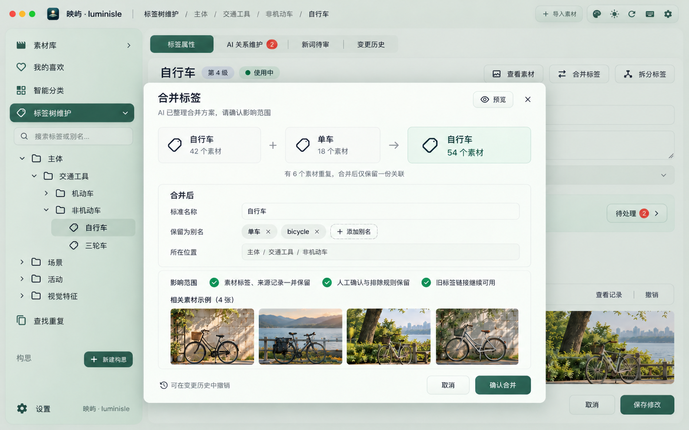
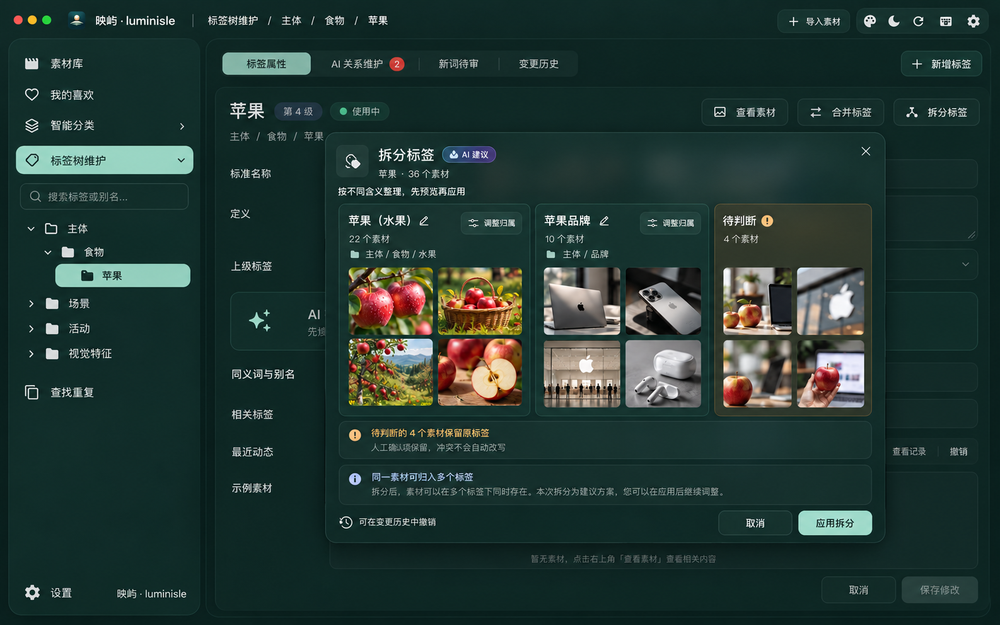

# 第二版关键 UI · 单侧栏、AI 关系维护与标签合并／拆分

2026-10-30。产品视觉评审稿，使用内置 imagegen 生成；是未来界面设计，不是已实现的软件截图。图片、文件名、素材数均为合成示例，不代表用户资料库或模型实测准确率。四图均为 1586 × 992 PNG。

本版取代第一版的常驻第二列分类树与逐条人工批准别名流程。两个一级入口仍分别保留；树在对应入口下面展开，默认只展开当前入口，主区完整用于图集或编辑。展开箭头保持独立焦点、中性色与紧凑缩进；精确交互、树缩进、层级标记及细小文案以正式规格为准。

## 01 智能分类图集 · 深色墨玉

“智能分类”下直接展开标签树，图集占满右侧主区。搜索和筛选贴近顶部，面包屑显示当前位置，数量和后台状态放 footer。选择父标签默认包含子级，可切换为仅本级。

## 02 标签维护与 AI 关系整理 · 亮色墨玉

“标签树维护”下直接展开同一标签体系，右侧编辑标签属性。开启 AI 维护后，无歧义的同义表达和相关关系自动整理；歧义、冲突才进入待处理。保留来源、历史、撤销和人工修正入口，不要求每条别名都手工批准。

别名属于同一概念；近义、相关概念独立保留，不因语义接近而合并。AI 关系维护不等于自动批准新概念或待审素材标签。

## 03 已有标签合并 · 亮色墨玉

AI 准备“自行车”和“单车”两个现存概念的合并方案，展示名称、别名、位置与影响范围，一次确认后执行。示例为 42 + 18 − 6 = 54 个去重素材关联，不复制或删除源媒体文件。

同一事务内保留来源、人工决定和旧概念重定向；双方已有别名默认完整保留，图中别名 chips 为节选，02 图里的“脚踏车”也应保留。存在后代、别名或排除规则冲突时，先解决冲突。撤销按变更记录执行，有后续冲突时需先处理，不承诺任何状态下都能无损撤销。

## 04 现存标签拆分 · 深色墨玉

AI 对已有“苹果”标签提出水果／品牌两个概念及素材归属方案。示例 36 个素材中，22 个水果、10 个品牌、4 个待判断。未决素材保留旧标签，不强制分配；实际允许一张素材归入多个目标标签，因此一般情况下目标数之和不一定等于去重总数。

支持调整目标名称、父路径与分配，人工确认和排除冲突不会被悄悄改写。界面整体确认方案，不要求逐张重新标注。原标签何时停用、旧词搜索如何分流及撤销冲突遵照正式设计。

## 搜索：现有能力与规划

最新补充（PNG 尚未绘入）：各素材浏览视图统一显示“已有标签”图标。网格与既有角标并排，紧凑列表／表格放在状态区；悬停或聚焦显示标签数量。人工及已生效自动标签均计入，仅有待审建议不点亮；与 AI 分析角标独立。素材库、我的喜欢、分类及搜索结果、选择器、重复／相似和工程素材列表遵循同一规则。现有单条／批量图片视频分析增加“同时整理标签”，优先复用本次或已有分析结果；详见 [设计 §2.1／§5.1](../design.md)。

- **现有代码**：标签名称已写入 `media_fts`，与文件名、描述等字段共同参与综合搜索；赋标签后会更新索引。不是仅按标签 ID 精确筛选。
- **本次规划**：标准名与已生效别名解析到同一概念；选父标签可包含后代并去重；同名异义展示路径供选择；近义、相关词仅提供显式扩展建议。合并保留旧词入口，拆分提示选择目标含义。
- 代码依据：`backend/blueprints/library.py` 的 `list_media` 搜索分支、`backend/blueprints/analysis.py::_refresh_fts`、`backend/blueprints/tags.py::assign_tags`。本轮仅静态核对，未验证本机生产安装包版本或真实资料库索引完整性。

## 后续已采纳的规则补充（未重绘 PNG）

- 搜索保留普通回车全文检索；明确选标签才生成条件，支持任一、全部和临时不包含。两个侧栏树都可查找名称／别名、显示完整路径并定位。
- 无模型时仍能手动创建、编辑、合并或拆分；图中的 AI 方案是辅助入口，不是保存前置条件。
- 已有概念的正向补标只有策略开启、独立验证达标且无人工冲突才自动生效；剩余素材建议按标签和导入批次分组审核。关系自动维护不授予素材自动应用权限。
- 动态图集放在现有“智能分类”入口内，保存条件；例图辅助放在标签定义区域，维护正例／易混反例并预览限定范围候选，确认前不形成正式标签。

这些内容和最新角标尚未绘入四张 v2 PNG；以 [产品设计 §2、§5～8、§12～13](../design.md) 与验收矩阵为准，不能把现有图稿当成新功能完成截图。

## 交付核对

已目视核对单侧栏结构、双一级入口、AI 自动关系维护、合并计数及拆分未决保留；已核对 PNG 文件头和尺寸。生成图用于视觉评审，细部文字及层级标记不是行为契约。未改业务代码，未运行软件功能测试或更新生产应用。

[完整提示词与参考图记录](prompts-v2.md) · [需求](../requirements.md) · [产品设计](../design.md) · [验收计划](../acceptance-matrix.md)
