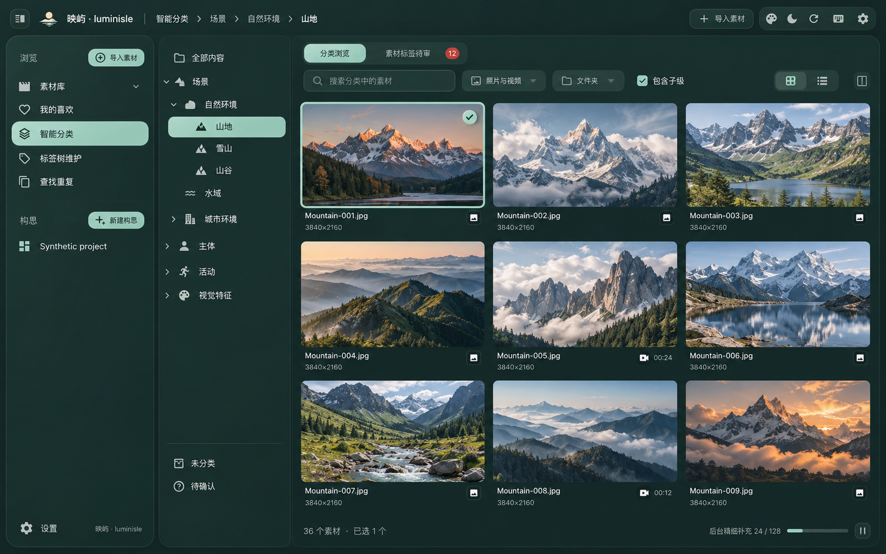
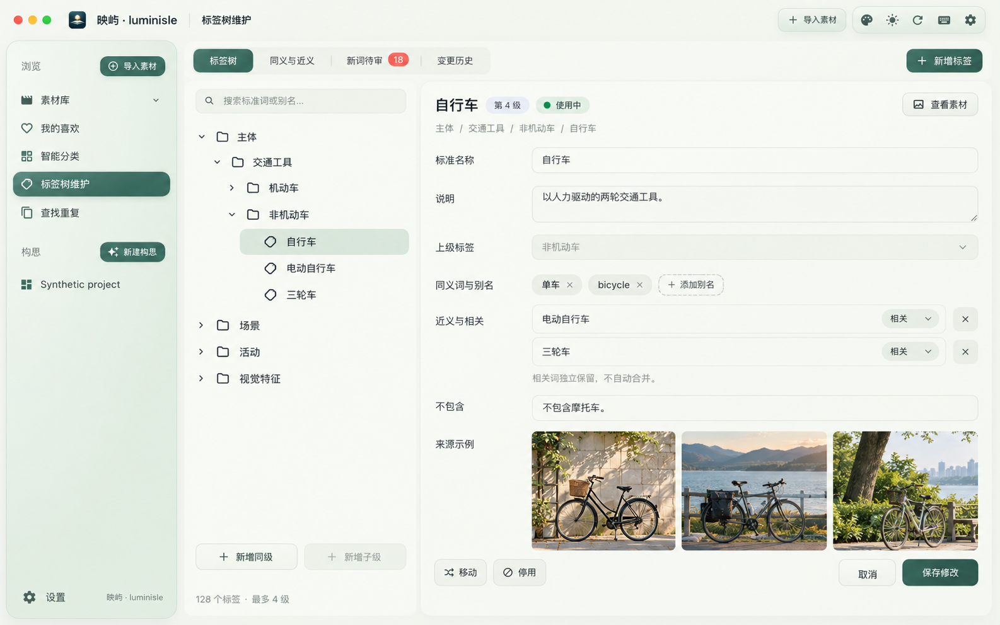
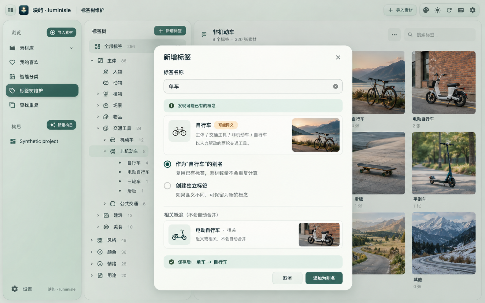
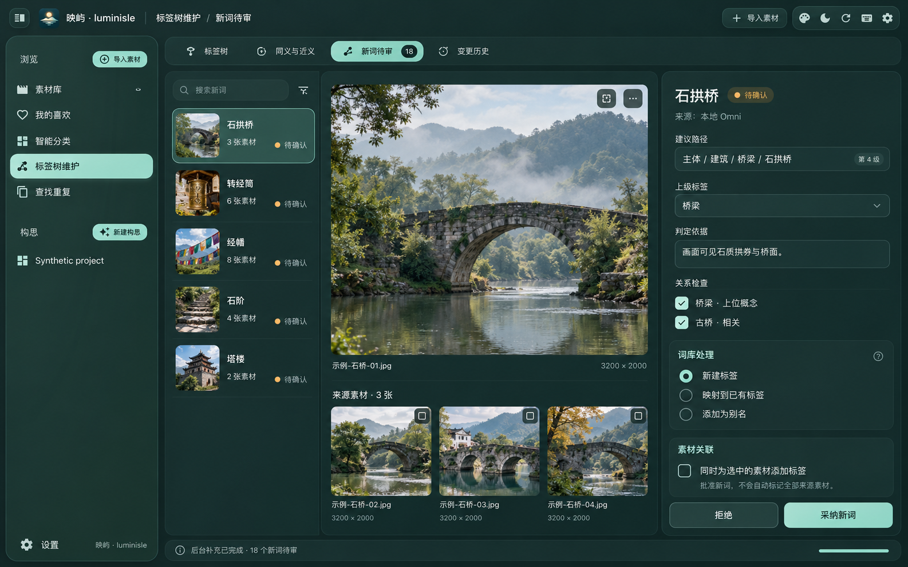

# 关键 UI 设计稿 · 2026-10-30

**当前版本：[第二版关键 UI](README-v2.md)**。已按最新反馈将标签树收进全局左侧菜单，增加 AI 自动关系维护、已有标签合并与拆分。请以第二版和正式规格评审当前方案。

## 第一版历史记录（已被第二版取代）

以下图片及说明保留用于追溯；其中主区第二列树和逐条人工批准别名的设计已废弃，不作为后续实施依据。

产品视觉评审稿，使用内置 imagegen 生成。以现有应用的合成测试截图和正式图标为视觉参考；图片、文件名、计数均为示例，不代表真实资料库或识别结果。尚未修改应用界面代码。生成图中的细小文字、背景示例树和图标细节仅用于风格评审，行为及层级以正式需求和设计文档为准。

四图均为 1586 × 992 PNG，保留紧凑 header、两个独立一级入口、统一圆角和克制边线；深色不使用亮白色面板边框。

## 01 智能分类浏览 · 深色墨玉

主区窄分类树搭配宽素材网格，检查器收起；分类路径放在 header，素材数与后台进度放 footer。

## 02 标签树维护 · 亮色墨玉

四级树与节点属性并排；标准词、别名和相关概念分开维护，别名不占树层级。

## 03 新增标签与同义关系

新增“单车”时提示复用“自行车”，提供“添加为别名”或“创建独立标签”；相关词单独列出，不自动合并。

## 04 Omni 新词审核 · 深色墨玉

候选列表、来源图片和审核属性并排。父类、关系、可见依据可复核；“采纳新词”与“同时为选中的素材添加标签”独立，后者默认不勾选。

已目视核对双入口、别名属性位置、最多四级示例、同义／相关区分、未勾选的素材关联，以及不展示 Omni 置信百分比。PNG 文件头、尺寸和本地引用已检查；本轮未进行软件行为或浏览器测试，图片不是功能完成证据。

生成方式与[完整提示词](prompts.md)已保存。源生成图保留在 Codex 默认目录，当前选定版本复制到本目录，不覆盖正式品牌资产。
