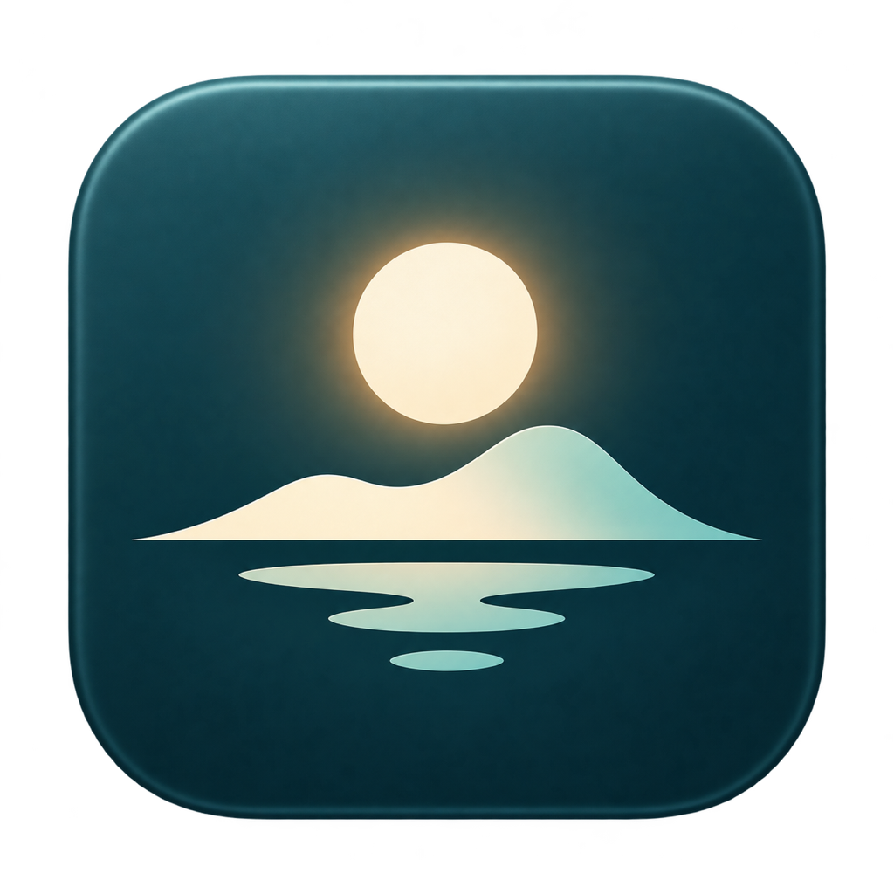

# 映屿 · luminisle

2026-10-21 起，项目的用户可见名称为 **映屿 · luminisle**。图形使用已确认的暖色日光、双峰岛形和横向水纹倒影，主图标不带文字。中文名称使用完整的 Unicode 字符“映屿”，避免把生成图中的缺笔字作为界面文字。

## 图标来源与导出

- `electron/app-icon.png`：1024×1024 RGBA 母版，按确认稿通过内置图像工具整理为独立图标，保留透明外角。
- `electron/dock-icon.png`：Dock 使用的 1024×1024 图标。
- `frontend/icon.png`：网页标题栏、favicon 使用的 256×256 图标。URL 带品牌版本参数，避免旧缓存继续显示旧图标。
- `electron/icon.iconset/`、`electron/icon.icns`：Finder 与 macOS 应用包使用的标准多尺寸图标。
- `electron/icon.svg`：内嵌同一 PNG 的独立 SVG 封装，保持既有入口兼容；不是可无限缩放的矢量原稿。

在 macOS 上运行 `python3 packaging/build_icons.py` 可从母版重新导出全部尺寸；`npm run build:mac` 会先执行该步骤。不要分别编辑衍生图标。

## 名称与升级兼容

窗口、菜单、关于面板、网页标题、侧栏、打包产品名称使用“映屿 · luminisle”。安装产物使用 `Luminisle-<version>-<arch>`，新的资料库导出副本使用 `Luminisle-Data-` 前缀。网络 User-Agent 使用 ASCII 产品名 `Luminisle`。

以下标识保留，以便新版继续读取原资料库、模型配置和界面偏好：

- npm 包名 `media-manager` 和包标识 `com.zack.media-manager`。
- `~/Library/Application Support/Media Manager` 用户配置及其中的 `library`。
- `MEDIA_MANAGER_*` 环境变量、健康检查标识、后端可执行文件名、原有导入导出格式和外部模型目录。
- Git 仓库 URL 与已有历史发布记录。

2026-10-22 已将本机应用由 1.0.8 升级为 1.0.9，安装于 `/Users/zack/Applications/映屿 · luminisle.app`。升级前后逐表校验一致，并验证自动生成的数据库快照。详情见 [本地升级记录](local-update-1.0.9-2026-10-22.json) 和 [升级与迁移说明](UPGRADE-AND-DATA.md)。

## 深色模式

界面主题通过预加载接口同步到 Electron `nativeTheme`：深色对应 `dark`，浅色对应 `light`，跟随系统对应 `system`。因此 macOS 原生窗口、透明外缘与网页内容使用同一外观。深色玻璃高光和媒体工具条边框使用独立的较低亮度参数；选中和键盘焦点仍保留主题色。

验证命令和隔离要求见 [回归测试](../tests/README.md)。本轮截图与验证结果保存在本机忽略目录 `build/luminisle-branding/`。

## 完整外观主题

已新增四套亮暗主题及统一的外观切换面板，仅调整颜色和材质，保留现有布局；1.0.9 同步音频波形缩略图的主题色。使用方式、持久化与验证范围见 [外观主题](THEMES.md)。本项已包含在本机安装的 1.0.9 中。
