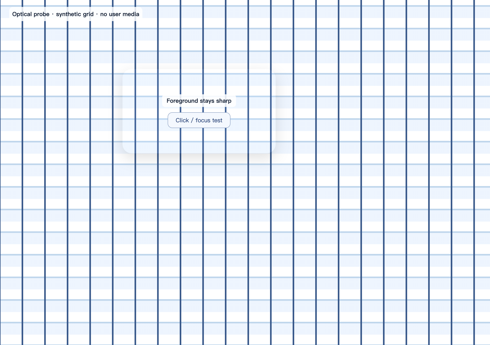
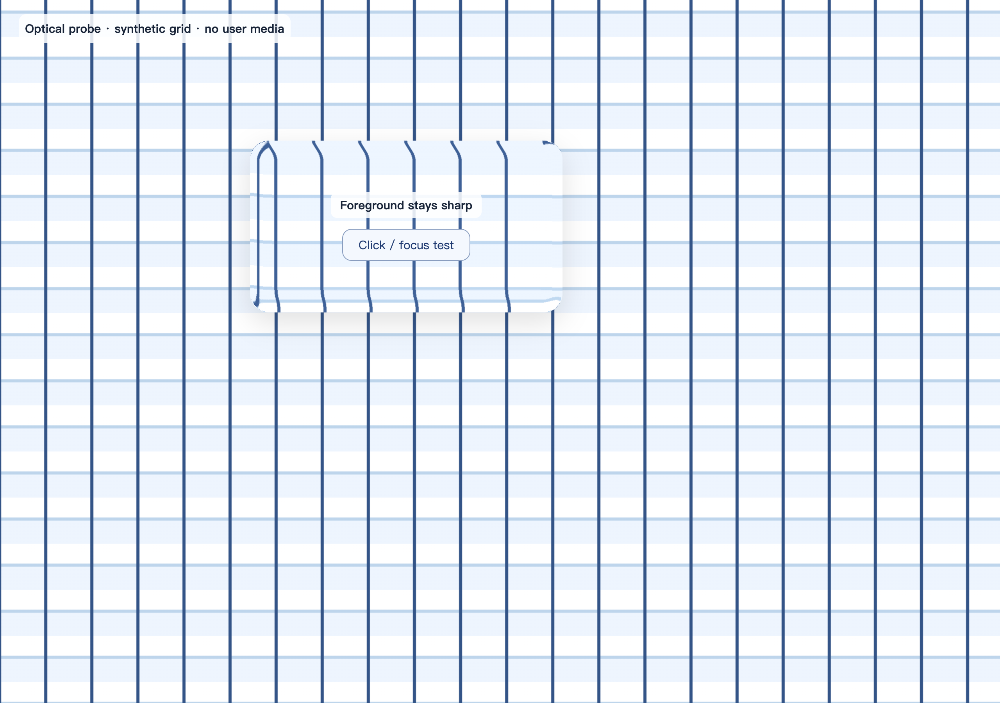

# Liquid Glass 开源方案评估

2026-10-18。评估对象为 [kwlck/liquid-glass-web](https://github.com/kwlck/liquid-glass-web)，固定提交 `a77866771c280eb3edfc108111a01541db6634dc`，包内版本 `0.1.0`。

## 结论

**已证明这个候选技术可用；正式依赖选型尚未确定。** 此前只对该小型实现做了运行评估，没有完成高 Star 候选的同场景比较，不能据此认定它是最佳方案。若后续采用，建议先覆盖小型工具组、弹出菜单和媒体悬浮控件。当前 Electron 能渲染实际边缘折射，不需要更换 Vue / Quasar 或升级 Electron。保持现有 20px / 14px 圆角与 8px 间距，可以统一视觉语言。

不建议给每个内容面板、每张缩略图和整个时间线增加折射。侧栏后面目前主要是平坦背景或 macOS 原生窗口材质，网页折射的视觉收益较小；悬浮于网页图片、视频上的控件收益更明确。网页 SVG 滤镜不能据此获得苹果原生 Liquid Glass 的全部桌面光学效果。

本次是隔离评估。仅在浏览器内临时注入开源代码，另在专用临时副本验证了一处兼容调整；**没有接入产品源码、修改依赖、替换已安装应用或写入真实资料库**。

## 可重复打开的预览

旧 `/tmp/.../probe.html` 属于已清理的测试目录，且内置浏览器禁止 `file://` 地址。预览现保存为 `docs/liquid-glass-preview.html`，内联所需样式、已评估的源码和 MIT 许可，不依赖临时目录或外部资源。页面提供折射对照、强度调节、深浅色及点击测试。

内置浏览器使用 [本地 HTTP 预览](http://127.0.0.1:8769/)。地址依赖本地服务运行；服务关闭后，在终端重新启动：

```bash
python3 /Users/zack/program/python/video_analyzer/docs/serve_liquid_glass_preview.py
```

服务仅绑定 `127.0.0.1`，只提供这个预览页面；其他项目文件均不开放。已在内置浏览器实际打开并检查，在独立 Chromium 通过滑块、点击、主题、重置、刷新与窄窗口检查。页面不访问资料库；这仍是单项效果演示，不表示已经完成正式选型。

## 高 Star 候选补查

用户随后指定的 `dashersw/liquid-glass-js` 与 `AndrewPrifer/liquid-dom` 已另行完成固定源码、Chromium 和现有 Electron 的隔离比较，见 [两项目对比报告](LIQUID-GLASS-COMPARISON-2026-10-18.md)。它们的结论不能套用到下表三个仅做源码补查的候选。

2026-10-18 核对 GitHub 仓库页面显示值（近似值，后续会变化）：

| 候选 | Star | 许可证与形态 | 当前应如何看待 |
| --- | --- | --- | --- |
| [rdev/liquid-glass-react](https://github.com/rdev/liquid-glass-react) | 约 6.4k | MIT；React 组件，peer dependency 为 React / React DOM 18+ | 社区关注度明显更高，应纳入对照；当前 Vue 3 / Quasar 项目需要适配其核心或合适的 Vue 实现，不能直接把 React 组件当作 Vue 组件引入 |
| [shuding/liquid-glass](https://github.com/shuding/liquid-glass) | 约 1.2k | MIT；原生 JavaScript / SVG，仓库用法为控制台粘贴演示 | 无 React 依赖，值得参考和补测；源码当前会自行创建可拖动浮层，需要改造为可复用、具备完整生命周期的项目控件 |
| [naughtyduk/liquidGL](https://github.com/naughtyduk/liquidGL) | 979 | 源码 MIT，演示资源另有排除；WebGPU / WebGL 路径 | 是更有社区关注的无框架候选；需要单独验证与现有布局、视频实时内容和 GPU 成本的关系 |

这次补查验证了仓库描述、相关源码/依赖及许可，没有对这三者执行本报告前述性能测试，不能从 Star 数推导其在本项目中的性能优劣。后续正式比较应同时覆盖社区采用、近期实质维护与问题响应、许可、Vue / Electron 兼容性、交互保留及同场景性能；此前的小库保留为技术基线。

## 许可证与实现

- [MIT 许可证](https://github.com/kwlck/liquid-glass-web/blob/a77866771c280eb3edfc108111a01541db6634dc/LICENSE)。若引入，需保留版权和许可文本；演示照片不属于该 MIT 授权，本项目无需引入这些照片。
- 核心三文件共 13,120 字节，包内没有运行时依赖。使用 CSS、SVG 位移滤镜和 Canvas 2D 生成位移贴图，主体显示不依赖 WebGL。
- 原组件内容与事件处理器保留；库增加装饰层、SVG 定义、`ResizeObserver` 和指针监听。无网络请求、页面截图上传或持续的内部渲染循环，尺寸变化和指针事件触发更新。
- 上游包版本仍为 `0.1.0`，本次按早期组件评估。后续应固定提交、保留小型适配补丁，不自动追踪 `main`。

以上根据所固定提交的 [源码](https://github.com/kwlck/liquid-glass-web/tree/a77866771c280eb3edfc108111a01541db6634dc/src) 与本机检查，非仅依据 README 宣称。

## 实测结果

| 项目 | 结果 |
| --- | --- |
| 实际桌面运行时 | Electron 35.7.5 / Chromium 134.0.6998.205，macOS Apple Silicon |
| 独立浏览器对照 | Playwright Chromium 153.0.8010.12，有界面运行 |
| 上游单元测试 | 3 项几何测试通过 |
| 上游浏览器检查 | 17 项在 Chromium 与实际 Electron 中均通过；临时兼容副本也通过 17 项 |
| 应用集成 | 两种运行时均通过侧栏尺寸、收起恢复、Vue 导航更新、设置页、选中/检查器、右键菜单、深色主题及销毁清理检查 |
| 小控件实测 | Electron 中增加玻璃材质后，工具栏按钮、弹窗键盘退出、菜单主题色选择及视频真实播放/暂停均可操作 |
| 资源清理 | 显式调用 `destroy()` 后，装饰层与 SVG 定义清零，原内容保留 |
| 减少透明度 | 实测关闭模糊/折射并显示实色背景 |
| 提高对比度 | 上游没有相应降级，须在项目适配层补齐 |

用合成网格分别截图折射强度 0 与 100，再做像素对照。Electron 的 32px 边缘环带中约 41.4% 像素发生超过 12 个色阶的通道变化，并能直接观察到格线弯折；这确认了实际渲染，而非仅检查 CSS 语法或 `renderer='svg'`。前景按钮点击及空格激活通过。

该像素检测用于确认折射存在，不代表光学准确度评分。截图像素比例已按 Chromium 的 1 倍和 Electron 的 2 倍进行处理。截屏来自网页渲染器，透明区域不包含 macOS 桌面合成层。

## 性能

以下是当前机器的短时对照，不能外推为所有机器上的帧率保证。

| 测量 | Electron 实测 |
| --- | --- |
| 240×40 工具组位移图生成 | 中位 0.9ms |
| 208×824 侧栏位移图生成 | 中位 10.8ms |
| 1024×768 大面板位移图生成 | 中位 46.1ms |
| CSS 对照，动画与连续缩放，帧间隔 P95 | 两轮分别为 9.4ms、9.0ms |
| SVG 折射，同样动画与连续缩放，帧间隔 P95 | 两轮分别为 17.5ms、16.9ms |

位移图生成测试每个尺寸重复五次，仅测算法 CPU 时间，不含 PNG 编码、滤镜上传和绘制。连续缩放测试同时放置三个表面（约 200×700 的侧栏、240×40 工具组、620×42 控制条），移动背景并逐帧改变侧栏宽度；每轮 2.2 秒，按无特效 / CSS / SVG / SVG / CSS / 无特效顺序对照，CSS 模式 blur=18，SVG 模式 blur=2、refraction=60。该负载刻意放大尺寸变化成本，不能理解为静止界面持续耗时 10.8ms。

在这些短时样本中没有捕获到大于 50ms 的 Long Task。未测长时间 GPU/电池消耗、多路高分辨率视频或大量同时折射的素材卡片。当前性能结果支持小控件方案，不支持全界面铺开。

## 接入前的具体适配

1. **覆盖原材质规则。** 现有 `native.css` 的渐变背景与 `backdrop-filter: blur(18px)` 带 `!important`。原样叠加会遮盖或重复处理新折射层。评估时仅在测试页面将宿主的背景和背景滤镜清空，再由开源装饰层提供材质；几何尺寸不变。
2. **处理初始化兼容问题。** 当前上游创建 `<feImage>` 时未设置初始 `href`。在 Electron 35 的页面加载阶段，实测资源计时列表出现空名称，可能触发开发环境 `logSecurityWarnings` 中的 `new URL('')` 异常。无库对照无空项，原库的 CSS / SVG 两条路径均观察到空项，改为绝对滤镜 URL 没有解决。临时副本在插入 SVG 前为 `feImage` 设置有效的中性初始图像后，空项消失，17 项浏览器检查通过。抛错受加载时序影响；这是已验证的兼容调整方向，不通过关闭安全检查解决。[Electron 35 对应代码](https://github.com/electron/electron/blob/v35.7.5/lib/renderer/security-warnings.ts#L97)
3. **绑定 Vue / Quasar 生命周期。** 弹出菜单关闭后宿主会从 DOM 移除，但库在 `body` 中添加的 SVG 还存在，必须调用该菜单实例的 `destroy()`。实测工具组与菜单共两个滤镜，菜单关闭后仍有两个；手动销毁菜单实例后释放相应定义。应通过组件/指令及弹窗显示、关闭钩子管理实例。
4. **补齐主题与辅助功能。** 为浅深色分别配置 tint 与实色降级色；除上游已有的减少透明度支持，还要在项目的提高对比度设置下关闭装饰层折射。保留当前减少动态效果规则和焦点样式。

SVG 背景滤镜依赖可采样的网页背景；父层滤镜、遮罩和层叠关系会限制采样范围。因此应在真实目标控件上验证，而不能仅根据独立演示推断全项目效果。技术背景参见 [CSS Filter Effects Level 2 草案](https://drafts.csswg.org/filter-effects-2/#BackdropRoot)。

## 后续建议与未验证范围

优先采用固定源码副本与上述小型适配，将可配置折射强度从较温和的数值开始，仅覆盖工具组、菜单和媒体控件。侧栏保留轻量透明材质，所有区域继续共用当前圆角、间距、边框和主题色。统一来自同一套设计规则，不要求每一块区域承担相同的滤镜成本。

未进行正式产品接入、完整功能回归、新安装包测试、外部显示器组合、其他操作系统或长期功耗测试。未访问真实素材、加载模型或调用付费 AI。测试后清理合成数据库、媒体、原生配置及临时服务，测试脚本、固定源码快照和详细数据保存在忽略的 `build/glass-library-eval/`。

## 光学对照截图

合成网格，折射强度为 0：



同一场景，折射强度为 100，可见边缘格线发生弯折：


