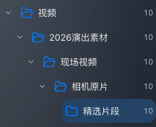
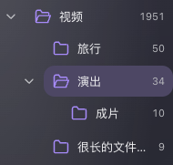
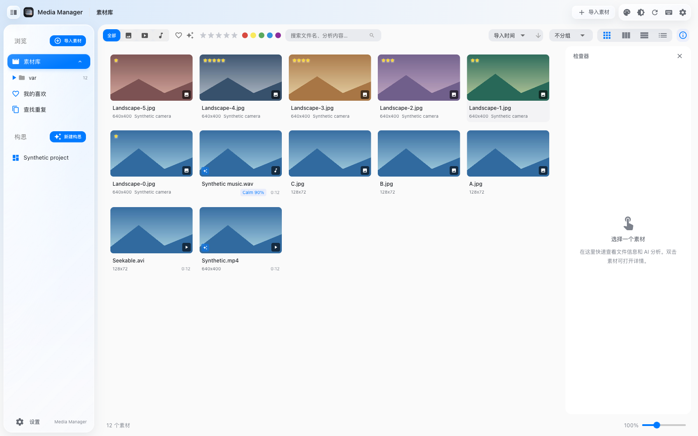
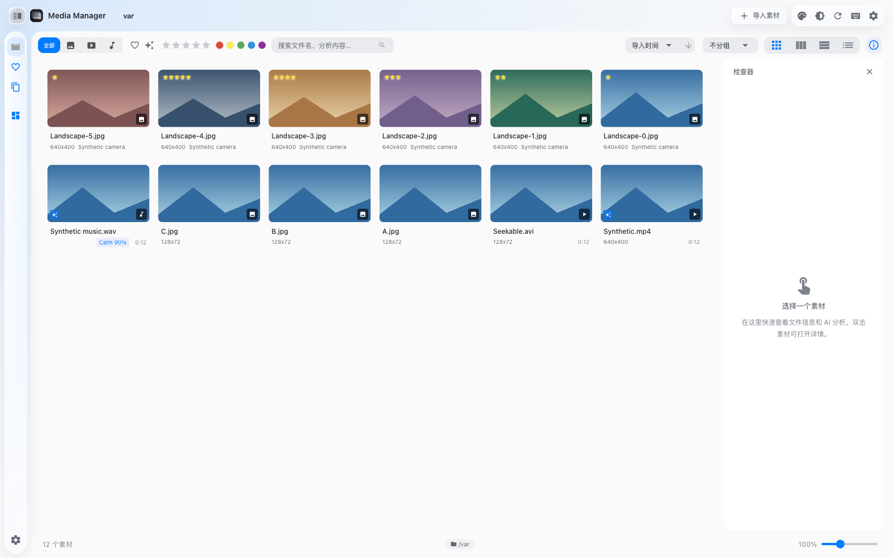
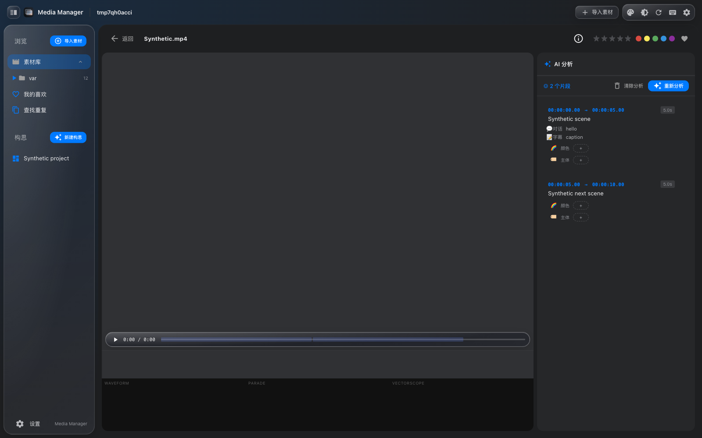
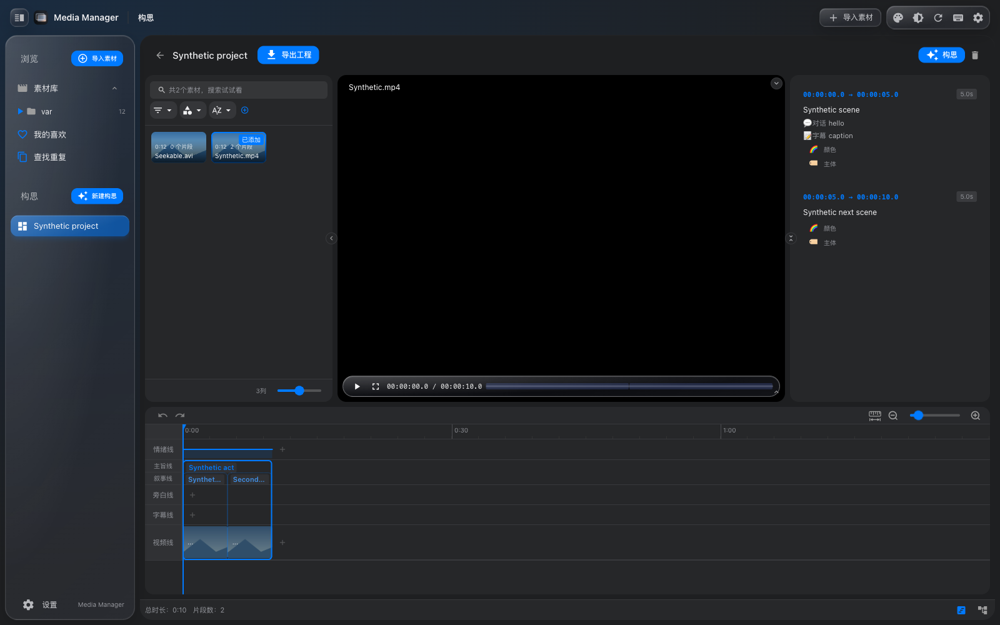

# macOS 界面重构

2026-10-18：依据已确认的素材库、详情页和工作台概念图，完成现有 Vue / Quasar / Electron 应用的桌面视觉重构。保留原组件、路由和业务接口，不修改数据库结构、媒体文件或模型。初次交付为源码；随后按用户要求构建并安装 1.0.3，再根据使用反馈完成紧凑布局和细节统一，更新到 1.0.4。应用位置为 `/Users/zack/Applications/Media Manager.app`；本轮验证与本地更新记录见 [UI 调整验证](ui-polish-validation-2026-10-18.json)。

## 界面与操作

### 文件夹树空间优化（1.0.6）

展开侧栏由 224px 加宽至 256px，折叠宽度仍为 56px。箭头图形由 16px 缩至 12px，保留 24×28px 点击区域和独立焦点。去掉箭头与文件夹行之间的 4px 间隙，文件夹行水平内边距由 9px 减至 4px，图标与名称间距由 8px 减至 6px；子级缩进由每层 20px 减至 16px。

五层合成目录中，最深层“精选片段”原先文字宽度仅约 10px，新布局可完整显示四字，右侧数量保持对齐。1000×600 与 1280×800、浅/深色均无整页横向溢出；独立点击/键盘焦点、打开/关闭图标、主题色、右键菜单、素材选择器、折叠导航以及最小窗口的详情页和工作台均已验证。记录见 [空间优化验证](folder-tree-compact-validation-2026-10-18.json)。本节替代下文历史版本的 20px 缩进规则。

已完成 1.0.6 本地升级与实际应用验收。全部 13 张表、10,960 条素材、2 个工程及 13,143 个受保护资料库文件与升级前一致；升级前数据库快照、已有备份和外部模型配置均保留。49 项后端、16 项前端、桌面路径检查，以及独立浏览器和原生应用中的 7 组文件夹树回归均通过。

### 文件夹树后续调整（1.0.5）

按用户提供的树形列表参考，展开箭头与文件夹行拆成独立目标。箭头使用中性色细线图形，有自己的悬停和键盘焦点；文件夹行的 12px 圆角高亮不覆盖箭头。文件夹使用跟随主题色的描边图标，展开时切换为打开图标，选中时使用主题色淡底。子级每层缩进 20px，保留右侧数量、长名称省略、右键菜单和创作素材选择器。

鼠标点击或键盘聚焦箭头后按空格/Enter 只改变展开状态；聚焦文件夹行后按空格/Enter 只切换选中状态，避免触发素材区快捷键。没有子目录的文件夹保留对齐占位，不显示可点击箭头。

先按用户要求在生产版 1.0.4 导入期间只构建，使用独立临时资料库和独立用户配置验证。随后用户确认导入完成并授权本地升级，已安装 1.0.5。升级前完整副本通过校验，升级后全部 13 张表、10,960 条素材、2 个工程和 13,139 个受保护资料库文件均与升级前一致；新增升级快照也与升级前数据库一致，外部模型配置与文件元数据保持不变。验证记录见 [文件夹树与打包验证](folder-tree-validation-2026-10-18.json)。原有截图和下文较早批次的检查记录保留其历史含义；文件夹行选中底色以本节的新参考为准。

| 区域 | 本次调整 | 保留的能力 |
| --- | --- | --- |
| 窗口与侧栏 | 统一工具栏、系统字体、半透明材质、蓝色选中态；macOS Electron 使用真实窗口按钮和拖动区 | 文件夹树、工程列表、导入、刷新与长按刷新、主题色、快捷键说明、侧栏收起 |
| 素材库 | 当前文件夹名称移至窗口 header，数量只保留在 footer；筛选栏位于主区域顶部，最右侧放检查器开关和批量分析入口 | 网格、瀑布流、等行高、列表、分组排序、搜索、高级筛选、评分、颜色、喜欢、框选、多选、右键菜单 |
| 检查器 | 显示选中文件、基本属性和已有分析；支持空选择、多选、加载失败重试和快速切换 | 仅通过现有读取接口获取分析；查看详情、在文件夹中显示、批量分析均复用原有操作 |
| 素材详情 | 放大预览区域、右侧分析面板、统一片段样式；顶部信息按钮展开完整元数据 | 视频播放定位、音频播放与情绪标签、图片缩放与平移、小地图、直方图、示波器、波形、片段编辑、XMP、重新分析与清除分析 |
| 工作台 | 更紧凑的素材面板、统一预览与检查面板、醒目的导出按钮、统一时间线配色 | 素材筛选拖入、轨道拖动和缩放、结构编辑、旁白字幕、情绪曲线、撤销重做、脑图切换、创作向导、FCPXML/SRT 导出 |
| 弹窗与设置 | 统一圆角、边框和分组；设置窗适应较小窗口 | 通用、图片、视频、音乐、剪辑构思五页设置，API Key、模型选择/下载入口、参数配置、导入、相似组排除与恢复 |

首次使用默认跟随系统外观；已保存的亮色/暗色选择、主题色、筛选和视图设置继续生效。系统外观在应用运行时变化也会同步。检查器开关单独保存于界面偏好；创作素材选择器保持完整宽度，不显示检查器。

图像/视频的完整元数据仍在：点击详情页工具栏的“文件信息”按钮。检查器为摘要，完整编辑仍在详情页。交互控件获得焦点时，Enter、空格和方向键交给控件处理；在素材区使用原有快捷键仍保持原行为。

## Liquid Glass 视觉迭代

根据后续确认，将导航与操作层调整为 Liquid Glass 风格：悬浮侧栏、圆角工具组、菜单和媒体控制条使用通透底色、渐变亮边、内高光与阴影；悬停时加强光泽。macOS 窗口启用 `under-window` 系统材质，渲染页面保留透明背景；浏览器使用浅色或深色的轻微色调背景。

整个主窗口采用同一套几何规则：素材库、详情、工作台和查重页外框均为 20px 圆角，与导航上下对齐；窗口外侧和面板间距均为 8px。检查器、详情工具条、素材面板、预览和时间线采用 14px 内层圆角，边缘内容正确裁切。后续精简了这些面板的重复边框，主要通过背景、留白和较轻的高光区分层次；选择、键盘焦点及时间线刻度仍保留必要标识。媒体图像、文字和时间线内容不应用模糊或扭曲滤镜。

当前 Electron 35 使用系统 `NSVisualEffectView` 材质与 CSS 光泽近似，并未接入 AppKit 的 `NSGlassEffectView`，不等同于苹果原生 Liquid Glass 的实时光学折射和形变。效果集中于导航与控件，内容层保持清晰，参考 [Apple Materials 指引](https://developer.apple.com/design/human-interface-guidelines/materials)。系统请求“减少透明度”或“提高对比度”时，控件切换为实色并关闭背景模糊；减少动态效果的设置继续生效。

本次视觉迭代重新通过 16 项前端回归、桌面路径检查、15 个既有浏览器场景、19 个界面场景、11 项玻璃材质与布局检查、3 项最小窗口检查，以及 7 项 Electron 检查。实际原生导出得到含 FCPXML 与 SRT 的 ZIP，CRC 和文件内容有效。布局检查逐页核对圆角、侧栏对齐及右侧/底部 8px 留白；工作台拖入素材、保存、脑图编辑和失败恢复均通过既有回归。

本次视觉迭代未改动后端业务代码，49 项后端测试结果沿用上一轮。后续 1.0.3 本地发布重新运行了 49 项后端测试、16 项前端检查、桌面路径检查及实际打包应用验证；本机新增视觉证据位于忽略的 `build/ui-liquid-glass/`，以下截图已更新为本次实际界面。

## 验证证据

### 紧凑布局与细节统一

- 移除素材库顶部独立的标题/数量行；header 显示当前文件夹、素材库或“我的喜欢”，窄窗口仍可见并省略过长名称，数量保留在 footer。
- 筛选栏贴主区域顶部；筛选控件允许换行，检查器开关固定在栏内最右侧。原有批量分析操作保留在其左侧，素材选择器继续隐藏检查器操作。
- 折叠侧栏的素材库、喜欢、查重、工程和设置图标使用相同中心线；折叠时隐藏分组标题，展开时保留完整标签。工程项去掉了单独的内边距。
- 文件夹树使用 Quasar 实际施加在 header 上的选中类，修正此前失效的选择器；悬停圆角和选中高光与主导航一致，均为 12px。
- 操作按钮统一使用 `--radius-control: 10px`；外层面板 20px、内层面板 14px 的几何层级保留。素材卡片悬停使用轻微底色，避免额外框线。
- 独立浏览器通过 9 项针对性检查，覆盖浅/深色、1000×600 / 1280×800 / 1600×1000、图标实际中心坐标、选中配色、按钮四角、检查器键盘与偏好、批量分析确认和详情/工作台。未执行真实分析或写入真实资料库。
- 本轮截图使用离线生成的合成风景图；新增折叠侧栏示例见下方。既有业务绑定与已安装 1.0.3 的前端源码逐项比对，430 个事件绑定和 72 个 `v-model` 绑定均保留。

- 保留性比对：7 个现有界面模块中的 **273 处操作绑定、65 个 `v-model` 控件绑定**均保留。此项是静态比对，结合下列行为验证使用。
- Python：49 项隔离测试通过。
- 前端：16 项组件行为回归通过，包括检查器的旧请求隔离、失败重试、取消选择和键盘焦点。
- 原有浏览器回归：15 个场景，涵盖筛选异步、保存并发、撤销、AVI 定位、向导取消/失败和片段编辑。
- 新界面浏览器检查：19 个场景，涵盖浅色/暗色实时切换、四种视图、搜索/空结果、检查器、多选、评分、高级筛选、导入入口、设置五页与语言、三类媒体、相似检索、工作台及窄窗口。
- 实际 Electron：6 项检查，使用独立用户配置与合成资料库。验证真实 macOS 窗口按钮位置、预留拖动区域、预加载接口和原生文件写入；导出的 ZIP 经 CRC 检查，包含有效 FCPXML 与 SRT。
- 窗口尺寸：1000×650、1280×800、1600×1000、1920×1080；主区域无整页横向溢出，设置操作区可见。
- 最小 1000×600 窗口另通过 3 项边界检查：详情元数据可滚动且保留视频区域、工作台预览与轨道可见、设置操作区可见。
- JavaScript 语法检查和 `git diff --check` 通过；浏览器与 Electron 检查未出现页面运行异常。

本轮只使用合成 SQLite、合成视频/音频和公开的 Lorem Picsum 风景占位图。演示截图中的文件名、分析及工程均为测试数据；占位图没有加入运行时素材库。没有调用付费 AI、启动真实模型推理、写入真实资料库或更改模型路径。

正常页面巡检没有发现意外的控制台异常、失败请求或 HTTP 错误。无封面音乐的封面读取返回预期 404，现有降级链继续显示波形，不影响播放。

本轮未重新调用真实云端分析、下载大型模型或在外部剪辑软件中导入导出文件。设置保存的浏览器验证检查请求字段并模拟响应，避免启动真实分析引擎；原生导出通过实际后端和 Electron 文件接口执行。

## 维护与复查

- 新视觉规则集中在 `frontend/css/native.css`，原有布局和轨道坐标规则留在 `main.css`。
- 检查器在 `frontend/js/media-inspector.js`，仅处理展示和既有接口请求。
- 系统主题监听和标题栏平台判断在 `frontend/index.html`；`electron/preload.js` 只增加平台标识，既有接口保留。
- 原有测试命令及隔离要求见 `tests/README.md`。
- `VIDEO_ANALYZER_UI_FIXTURE=1` 可为浏览器 fixture 增加合成音频；`VIDEO_ANALYZER_UI_POSTERS` 可指向可选 JPG 占位图目录。不提供占位图也可运行，不依赖联网。
- 三个原有浏览器脚本按 README 顺序运行；每次完整重跑都须新建 fixture，最后一个脚本会删除/重建合成片段以验证历史引用。
- 本机详细 JSON、回归日志和截图保存在忽略的 `build/ui-refactor/`；源码内的验证摘要见 `docs/ui-native-validation-2026-10-18.json`。

## 实际界面截图

